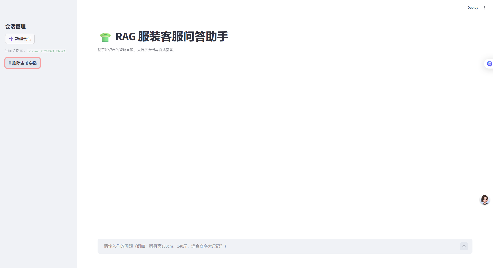
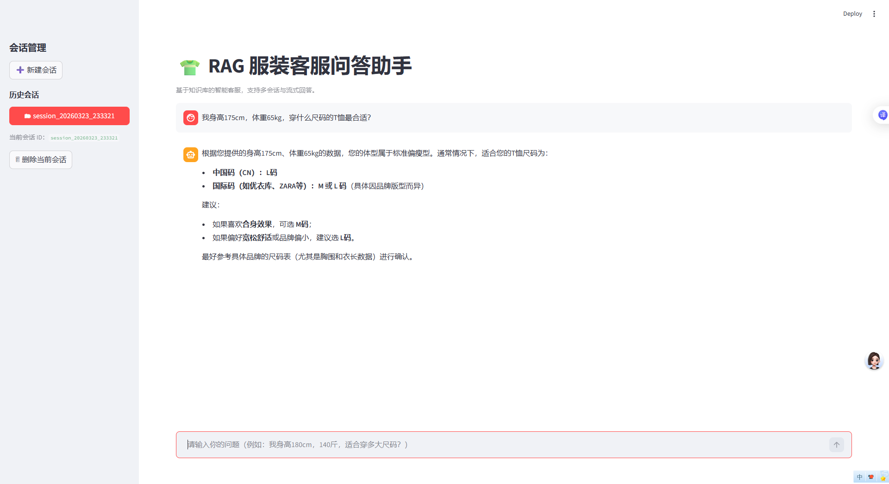
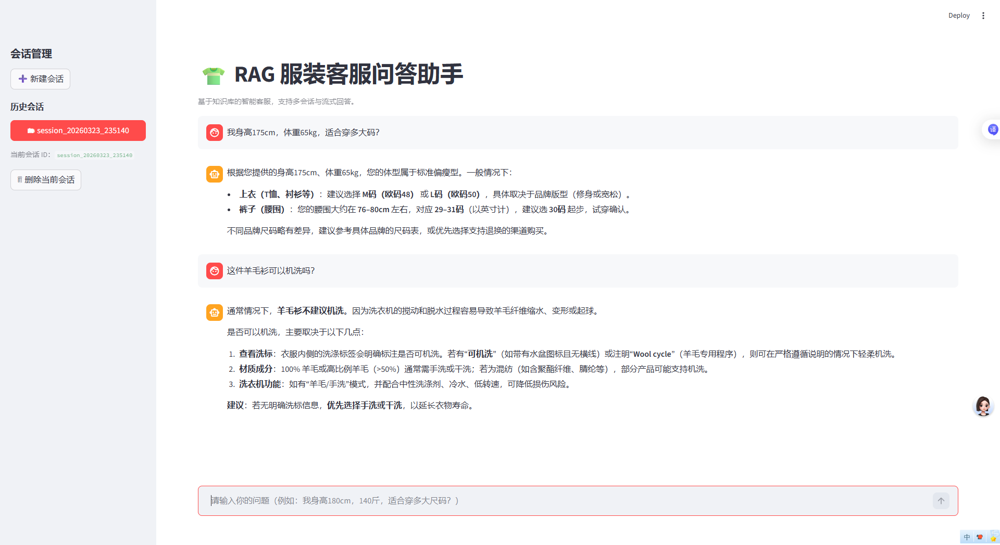
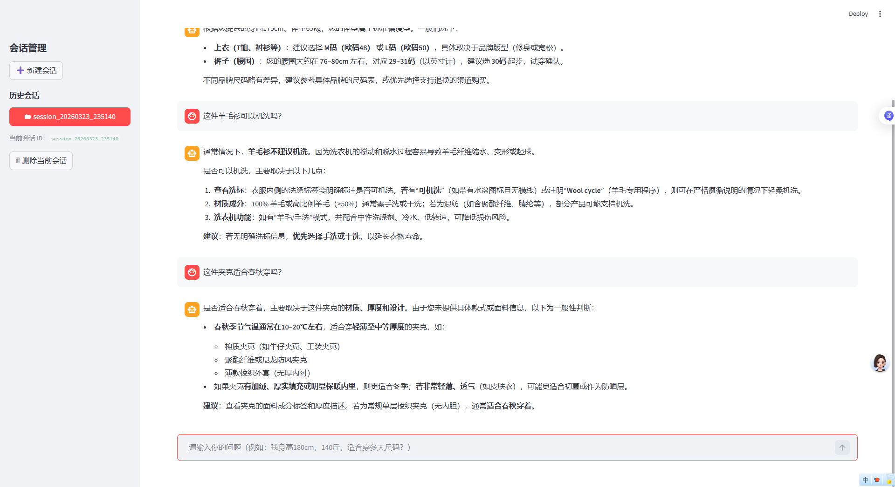
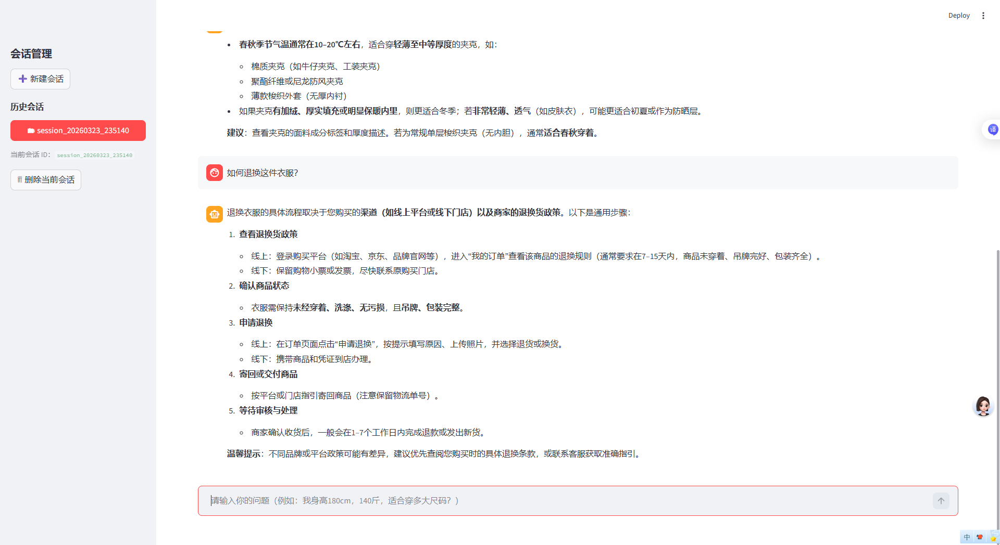
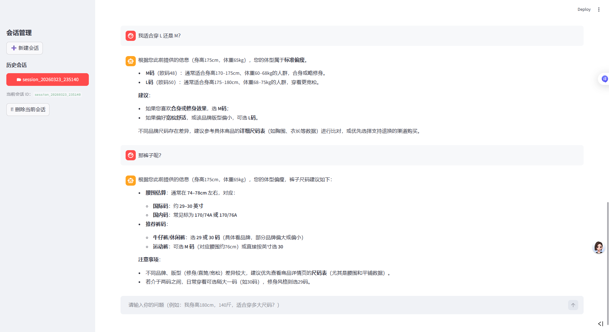

# RAG 服装客服问答助手学习复现项目
RAG Clothing Customer Service Q&A Assistant Learning and Reproduction Project

这是我为了准备复试、系统学习 RAG 与大模型应用开发而完成的一个学习复现项目。

---

## 项目说明 Project Overview

本仓库记录了我在学习过程中对黑马程序员 B 站课程《黑马程序员大模型 RAG 与 Agent 智能体项目实战教程》的复现过程。

- 视频链接（bilibili）：[点击查看](https://www.bilibili.com/video/BV1yjs2SBLEx)  
- 本项目仅用于学习和复现，不用于商业用途  

复现目标：复习复试知识 + 掌握 RAG + 大模型应用实战

---

## 项目目录结构

- rag-clothing-assistant-study/
- ├─ rag-clothing-customer-service/ # Streamlit 页面代码
- ├─ data/ # 知识库文件
- ├─ assets/ # 界面截图与示例图片
- ├─ requirements_fixed.txt # 项目依赖
- ├─ README.md # 项目说明

---

## 环境与运行 Environment and Operation

### 环境要求

- Python >= 3.10  
- 建议使用虚拟环境（venv 或 conda）

### 安装依赖
pip install -r requirements_fixed.txt

### 启动项目
streamlit run app_qa.py

浏览器打开 http://localhost:8501
 即可访问问答助手界面。

### 示例问题与系统回答

用户可以尝试以下问题（示例），贴近复试场景：

1. 衣服尺码推荐
- 我身高175cm，体重65kg，适合穿多大码？

2. 洗涤和保养问题
- 这件羊毛衫可以机洗吗？
- 系统回答示例：请参考衣物洗标说明，若标注“干洗 only”，则不建议机洗；否则可手洗。

3. 面料材质与适用场景
- 这件夹克适合春秋穿吗？
- 系统回答示例：结合材质和厚度，适合春秋季穿着，夏季可能偏热，冬季可能不够保暖。

4. 退换货政策查询
- 如何退换这件衣服？
- 系统回答示例：可参考知识库中对应政策条目，或提供退货流程链接。

5. 多轮对话示例
- 用户：我适合穿 L 还是 M？
- 系统：根据身高170cm、体重68kg，推荐 M 码；如肩宽偏大，可考虑 L 码。
- 用户：那裤子呢？
- 系统：腰围约 70cm，对应尺码 30 码。

### 学习复现说明
- 所有代码均为本人复现，不代表官方版本
- 复现过程记录了运行步骤、问题与解决方案
- 主要目的是为了复试知识掌握和实践 RAG + 大模型应用
- 注意事项：本仓库仅作学习和复习用途，请勿用于商业用途
- 使用前请配置 .env 文件（API Key）